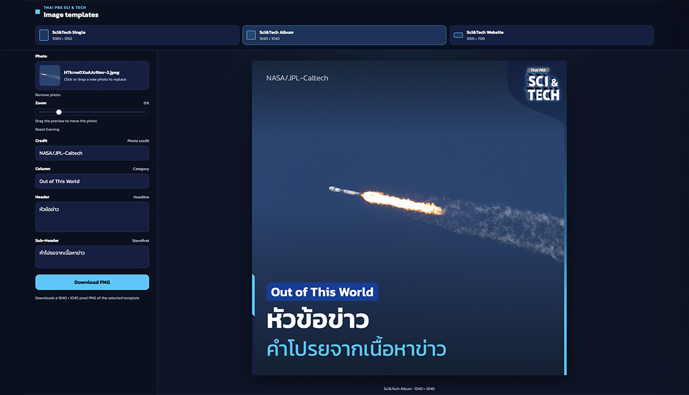

# Thai PBS Sci & Tech — image templates

A browser-only studio for making Thai PBS Sci & Tech social and website images. Choose a template, add a photo and text, then download a PNG. Nothing is uploaded to a server.



## Templates

Each template is its own HTML and CSS file under `src/templates`, so the layout can be adjusted without changing the others.

| Template | Size | File |
| --- | --- | --- |
| Sci & Tech Single | 1080 × 1350 | `src/templates/single.tsx` |
| Sci & Tech Album | 1040 × 1040 | `src/templates/album.tsx` |
| Sci & Tech Website | 1250 × 700 | `src/templates/website.tsx` |

Frame artwork for each card lives next to the template as `single-overlay.png`, `album-overlay.png`, and `website-overlay.png`.

## How to use it

1. Open the studio and pick Single, Album, or Website.
2. Add a photo by clicking the drop zone or dragging a file onto the page. Any image size is accepted. The file stays in the browser.
3. Reframe the photo on the preview. Drag to move it. Use the zoom slider to crop in, or zoom out as far as −40% so the subject can sit clear of the overlay. **Reset framing** returns the photo to a centered crop.
4. Fill in Credit, Column, Header, and Sub-Header. Empty fields are left off the card.
5. Download a PNG at the template’s exact pixel size.

The preview scales down to fit the window, with padding around the card. It is never scaled up, so the artwork stays sharp.

## How it works

The page is a Next.js app. The studio UI is a client component. It renders the selected template twice: once as the on-screen preview, and once off-screen at full size for export.

The download uses `html-to-image` to capture that full-size card as a PNG. Photos are read into memory as data URLs, and the cover crop is positioned with explicit width and offsets so the exported file matches the preview. There is no upload API and no database.

## Develop

```bash
npm install
npm run dev
```

Open [http://localhost:3000](http://localhost:3000).

```bash
npm run lint
npm run build
```

## Copyright

All templates, including their layout, typography, and overlay artwork, are copyright by Thai PBS.
